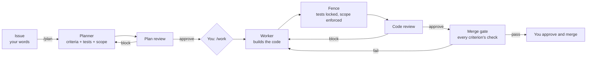

# δokima

**Coding agents now out-code us on narrow tasks. The bottleneck is knowing their work is actually done.**

δokima takes grading away from the agent that did the work, and moves your effort from writing code to verifying it.

**The problem:** agents drift when they check their own work.
**The answer:** your words become the contract. You own what "done" means; δokima guarantees the output passes that bar before it merges.

*δ is the first letter of δοκιμασία, Greek for test, trial.*

---

## Why δokima

- **Verification is the product.** Every acceptance criterion gets its own test, written before any code. GitHub's verdict on that test is the proof. No model's say-so counts.
- **A human at the root of every decision.** Not fully autonomous, by design. Plans and merges trace back to an owner's approval. The promise is not zero flaws; it is that you spend your time on verification, not on watching agents.
- **GitHub-native.** Nothing to host, no new dashboard. Issues, pull requests, comments and Actions are the whole interface. Every agent decision is a linked comment, so the issue is a full audit trail.

## How it works

The building block is **plan → review → work → review**, each step a separate agent on a fresh GitHub Actions runner.

1. **You open an issue** in plain words: what you want, rough or detailed.
2. **The planner** turns it into a short title, a user story, acceptance criteria, a test for every criterion and a scope (the files the work may touch). Large asks are proposed as a split into 2 to 5 sub-issues.
3. **The plan reviewer**, a separate session, grades the plan: would each test fail if its behavior were missing? A block goes back to the planner on its own; an approval stops for you.
4. **`/work`** is your approval. The worker builds on a fresh machine and opens a draft pull request.
5. **The fence** runs after the worker stops. It reverts every edit to a test or test-setup file and every change outside the plan's scope, and lists what it dropped. The worker cannot move its own finish line.
6. **The code reviewer** grades the result against the approved plan. Each blocker names who fixes it: the worker for code, the planner for a weak test.
7. **The merge gate** brings the branch up to date with `main`, marks it ready, and waits for every required check on that exact commit: `all tests` plus one `Acceptance criteria` check per criterion. A failure goes back to the worker.
8. **You approve and merge.** Only a passed gate asks you to.

Agents settle what they can between themselves. The loop stops and mentions you only for questions, approvals, escalations, a hand-back code rejected, or three blocking reviews in a row at one stage. Agents also raise real problems they find outside the issue; once a reviewer confirms one, δokima files it as its own issue (labeled `filed-by-dokima`).

**Code owns the structure; models fill in content.** Routing between stages, the fence, the card, labels and records are plain Python in [`dokima/`](dokima). Models write only plans, code and findings. Role prompts live in [`dokima/roles/`](dokima/roles).

## What you see

### The card

A card at the top of every issue, and the same card on its pull request, says where things stand in plain English. It is drawn by code ([`dokima/card.py`](dokima/card.py)) from the agents' records and GitHub's own check results, always from `main`'s copy, so the work being judged cannot change how it is reported. No model writes it.

| Line | What it shows |
|---|---|
| Summary | The plan's short plain title |
| Status | The stage (Backlog, Plan, Work, Review, Merged), plus **Needs you:** and your to-do when it is your turn |
| Links | The latest run, the pull request and its files changed |
| Stories / Blocked by / Blocks | Sub-issues of a split and GitHub's own blocked-by links |
| Acceptance criteria | Each criterion with GitHub's verdict on its check, linked to the proof |
| Scope | The files the work may touch |
| Original issue | Your ask, exactly as written, in a fold |
| Definition of Done | All tests · Code review · Owner approval, each with its verdict |

Every agent run also posts one record comment: what it did, what it raised, a Stats fold (model, time, turns, tokens, API-equivalent cost, links to the run and its full conversation) and the full JSON record. Each record ends with a **Next** line: what happens next, or what is yours to do.

### Commands

A command is the first word of a code owner's comment on the issue or its pull request, or of a pull request review submitted as a comment or a change request. Everything after the command, and every other comment and line note, reaches the agent. Only owners of `*` in [`.github/CODEOWNERS`](.github/CODEOWNERS) count.

| Command | Where | What it does |
|---|---|---|
| `/plan [your words]` | issue or PR | The planner plans, or re-plans with your words |
| `/review` | issue | The reviewer grades the plan (also: go on with the planner's assumptions) |
| `/review` | PR | The reviewer grades the work |
| `/work` | issue or PR | Approves the plan; the worker builds it. On an approved split, files its stories as sub-issues |
| `/autopilot start` | issue or PR | Puts the issue and every sub-issue under it on autopilot and picks up what was waiting |
| `/autopilot stop` | issue or PR | Takes that tree off autopilot |

- No command, nothing starts. Bot comments never start anything.
- An **Approve** review never starts a stage. It only ever means merge.
- Labels do not start stages. The only label you will see change is `autopilot`, which `/autopilot` sets.

### Autopilot

On an issue on autopilot, an approved plan starts the worker and an approved split files its stories, each with one `Autopilot:` line on the issue where you would have typed `/work`. A blocked issue plans only after its blockers close. A passed merge gate asks GitHub to merge; GitHub's own branch rules decide whether that merges, joins the merge queue or waits for your approval. A pull request that changes a workflow file always stops for you.

### The board (optional)

Set the repo variable `DOKIMA_BOARD` to a GitHub Project (`org/number`) and code keeps it current: columns Backlog, Plan, Work, Review, Done; a **Needs you** or **Autopilot** pill on each card; a Blocker priority from blocked-by links. Without it, everything still works on the issues themselves.

## δokima builds itself

δokima is developed through its own loop. Dogfooding, October 2–14, 2026:

| | |
|---|---|
| Merged pull requests authored by the bot | 162 of 197 |
| Issues taken from plan to merge through the loop | 125 |
| Agent workflow runs that fail | about 2.5% |
| Tests in the suite | 1,150 |

## Install

> **Onboarding other repositories is in progress**, tracked in [#272](https://github.com/dokima-dev/dokima/issues/272) (one-link onboarding for any repo). Today δokima runs on its own repository. The list below is what that setup uses, for those who want to try it by hand.

Requirements:

- A GitHub repository with Actions enabled. Runs use your GitHub Actions minutes.
- A GitHub App installed on the repo, with the permissions in [`dokima/app.json`](dokima/app.json). Agents act as this app, never as a person; it cannot approve.
- A Claude subscription. Agents run Claude Code on GitHub-hosted runners.
- Today the test runner is `pytest` on Python 3.12.

Setup:

1. Add [`dokima/install/dokima.yml`](dokima/install/dokima.yml) to the repo as `.github/workflows/dokima.yml`. It runs δokima from this repo at the newest release, `v0.1.4`; nothing else of δokima is copied.
2. Add [`dokima/install/settings.yaml`](dokima/install/settings.yaml) to the repo as `.dokima/settings.yaml`, naming only what differs from the defaults.
3. Add the repo secrets `DOKIMA_APP_KEY` (the app's private key) and `CLAUDE_CODE_OAUTH_TOKEN`. Make them repo secrets: secrets kept only in an environment never reach δokima's jobs. `dokima.yml` hands each secret to δokima by name; settings naming another agent key (`CODEX_API_KEY` or `KIMI_API_KEY`) must add its line there too. Settings may name only the agent keys `CLAUDE_CODE_OAUTH_TOKEN`, `CODEX_API_KEY` and `KIMI_API_KEY`. Any other never reaches the jobs, and the audit and the run say so.
4. Set the repo variable `DOKIMA_APP_ID`. Optionally set `DOKIMA_BOARD`.
5. Add `.github/CODEOWNERS` with a `*` line naming who may give commands and approve.
6. Protect `main`, requiring the checks `dokima / full-suite / all tests` and `dokima / acceptance-criteria / Acceptance criteria`. GitHub shows them under these full names, since they run inside `dokima.yml`.
7. Open an issue and comment `/plan`.

A daily audit ([`audit.yml`](.github/workflows/audit.yml)) compares the repo's settings with what δokima needs ([`dokima/manifest.py`](dokima/manifest.py)) and reports drift on one pinned **Setup** issue.

## Principles

- **Nothing merges until it is proven.** Every promise in a plan has its own check; GitHub's verdict is the proof.
- **Separation of duties.** The agent that builds never grades. Planner, worker and reviewer are separate sessions on separate machines and talk only through recorded hand-backs.
- **Tests are locked.** The planner's tests are fixed before work starts; the fence reverts any worker edit to them.
- **Fail closed.** Missing proof, a missing reviewer or a broken check blocks, and the issue says why.
- **The judge runs from `main`.** Checks, cards and agent code always come from the default branch, never from the pull request being judged.
- **Least privilege.** Agents hold no GitHub key while they work; code checks their output, then posts it.
- **Your attention is the scarce resource.** The card shows only what you need at a glance; the rest is folded.
- **Agent-neutral by design.** Roles are prompts and hand-backs, not vendor code. Today the agent is Claude Code.

The full specification is [`AGENTS.md`](AGENTS.md).

## Status and roadmap

Built and running on this repository:

- [x] Plan → review → work → review loop, routed by code
- [x] `/plan`, `/work`, `/review`, `/autopilot start|stop` commands, code owners only
- [x] Planner-written tests, one check per acceptance criterion
- [x] Fence: test files locked, out-of-scope changes reverted
- [x] Independent plan review and code review
- [x] Merge gate on the up-to-date head
- [x] Splits into sub-issues with blocked-by links
- [x] Agents raise questions to the owner and file issues they find
- [x] The card, run records and the optional project board
- [x] Autopilot across an issue tree
- [x] Daily settings audit

Planned:

- [ ] One-link onboarding for other repositories ([#272](https://github.com/dokima-dev/dokima/issues/272), in progress)
- [ ] Language-neutral: each repo declares its own setup and test command
- [ ] Other coding agents beside Claude Code
- [ ] Resume a crashed or timed-out run from its last commit
- [ ] `/issue` to file the issues agents raised on command
- [ ] MCP server
- [ ] Optional code-quality gates: complexity, import rules, diff coverage, mutation testing

## License

Apache-2.0.
