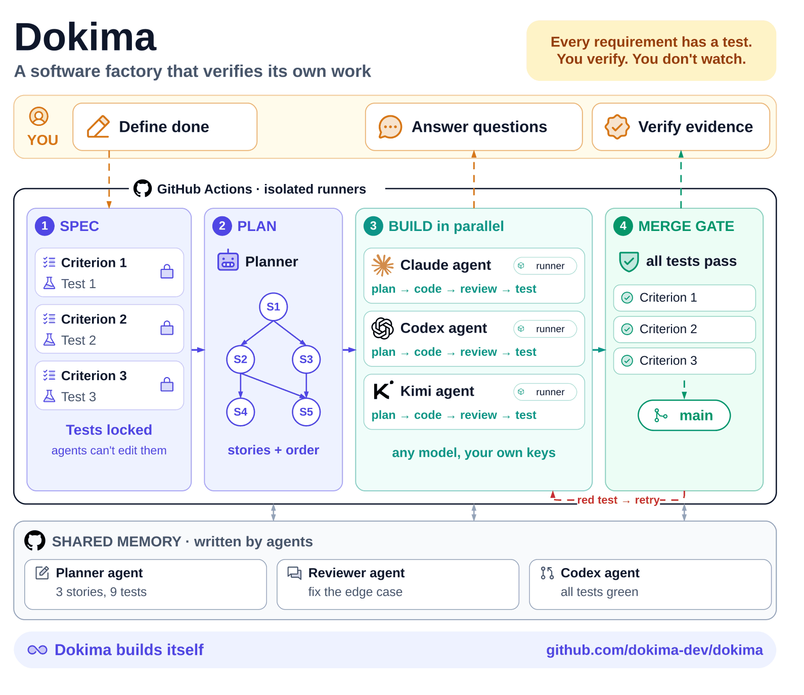

# δokima

**Coding agents now out-code us on narrow tasks. The bottleneck is knowing their work is actually done.**

δokima takes grading away from the agent that did the work, and moves your effort from writing code to verifying it.

  

  <a href="#how-it-works">How it works</a> ·
  <a href="#install">Install</a> ·
  <a href="#principles">Principles</a> ·
  <a href="AGENTS.md">Specification</a> ·
  <a href="docs/wiki/Home.md">Wiki</a>

*δ is the first letter of δοκιμασία, Greek for test, trial.*

## How it works

You touch three moments: you **define done**, you **answer questions**, you **verify the evidence**. Everything between runs as separate agents on fresh GitHub Actions runners.

1. **Spec.** The planner turns your issue into acceptance criteria, one test per criterion, and a scope. The tests are locked before any code exists.
2. **Plan.** Large asks split into stories with a dependency graph; stories with no blockers run in parallel.
3. **Build.** A worker writes the code; a separate reviewer grades it against the plan. The worker can't touch the tests or leave the scope.
4. **Merge gate.** Nothing merges until every criterion has a passing test on the exact commit that lands. A red test goes back to the worker.

Agents settle what they can between themselves and mention you only when it matters. Every plan, review and decision is a comment, issue or pull request, so the issue is a full audit trail and each agent starts warm.

## Why δokima

- **Verification is the product.** GitHub's verdict on each criterion's test is the proof. No model's say-so counts.
- **A human at the root of every decision.** Plans and merges trace back to an owner's approval, or to autopilot you switched on.
- **GitHub-native.** Nothing to host, no new dashboard. Issues, pull requests and Actions are the whole interface.
- **Any model, your own keys.** Each role runs Claude Code, Codex or Kimi, set per role in one settings file.

## Commands

A command is the first word of a code owner's comment on an issue or its pull request.

| Command | What it does |
|---|---|
| `/plan [your words]` | Plan, or re-plan with your words |
| `/review` | Grade the plan (on an issue) or the work (on a pull request) |
| `/work` | Approve the plan and build it |
| `/autopilot start` · `stop` | Run an issue tree without stopping for approvals |

Every issue carries a live card drawn by code from GitHub's own check results, and an optional project board follows along.

## Install

> One-link onboarding is in progress ([#272](https://github.com/dokima-dev/dokima/issues/272)). The steps below are the setup by hand.

You need a GitHub repository with Actions, a GitHub App with the permissions in [`dokima/app.json`](dokima/app.json), and a key for at least one agent. Today the test runner is `pytest` on Python 3.12.

1. Add [`dokima/install/dokima.yml`](dokima/install/dokima.yml) to the repo as `.github/workflows/dokima.yml`. It runs δokima from this repo at the newest release, `v0.1.8`; nothing else of δokima is copied.
2. Add [`dokima/install/settings.yaml`](dokima/install/settings.yaml) to the repo as `.dokima/settings.yaml`, naming only what differs from the defaults.
3. Add the repo secrets `DOKIMA_APP_KEY` (the app's private key) and `CLAUDE_CODE_OAUTH_TOKEN`. Make them repo secrets: secrets kept only in an environment never reach δokima's jobs. `dokima.yml` hands each secret to δokima by name; settings naming another agent key (`CODEX_API_KEY` or `KIMI_API_KEY`) must add its line there too. Settings may name only the agent keys `CLAUDE_CODE_OAUTH_TOKEN`, `CODEX_API_KEY` and `KIMI_API_KEY`. Any other never reaches the jobs, and the audit and the run say so.
4. Set the repo variable `DOKIMA_APP_ID`. Optionally set `DOKIMA_BOARD` to a project board.
5. Add `.github/CODEOWNERS` with a `*` line naming who may give commands and approve.
6. Protect `main`, requiring the checks `dokima / full-suite / all tests` and `dokima / acceptance-criteria / Acceptance criteria`. GitHub shows them under these full names, since they run inside `dokima.yml`.
7. Open an issue and comment `/plan`.

A daily audit compares the repo's settings with what δokima needs and reports drift on one pinned **Setup** issue.

## Principles

- **Nothing merges until it is proven.** Every promise in a plan has its own check.
- **The builder never grades.** Planner, worker and reviewer are separate sessions on separate machines.
- **Tests are locked.** The fence reverts any worker edit to a test or to files outside the scope.
- **Fail closed.** Missing proof or a broken check blocks, and the issue says why.
- **The judge runs from `main`.** Checks, cards and agent code never come from the pull request being judged.
- **Your attention is the scarce resource.** You see only what needs you; the rest is folded.

## δokima builds itself

δokima is developed through its own loop. In two weeks of dogfooding, the bot authored 162 of 197 merged pull requests and took 125 issues from plan to merge. Diagrams are in [`images/`](images).

## License

Apache-2.0.
