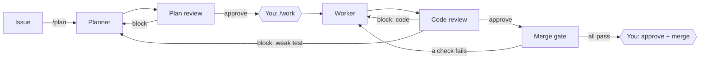

# How it works

One issue, one plan, one pull request. Three agents, each on a fresh GitHub Actions machine, each seeing only what code hands it. Code, not a model, decides what runs next.

## The loop

| Step | Who | What happens |
|---|---|---|
| 1. Issue | You | Say what you want, in plain words. See [[Writing issues|Writing-issues]]. |
| 2. `/plan` | Planner | Writes acceptance criteria quoting your words, and a failing test for each. Or proposes a split. |
| 3. Plan review | Reviewer | Grades the plan. Block → back to the planner, by itself. Approve → stops for you. |
| 4. `/work` | You | Approves the plan. The worker builds on a fresh machine and opens a **draft** PR. |
| 5. Code review | Reviewer | Starts by itself when the worker finishes. Block → back to whoever must fix it. |
| 6. Merge gate | Code | Brings the branch up to date with main, marks the PR ready, waits for every check main requires. |
| 7. Merge | You | Approve and merge. On [[Autopilot]], a passed gate merges by itself. |

No test runs on the PR while it is a draft, so nothing races the code review.

## Roles

| Role | Owns | Never |
|---|---|---|
| **You (owner)** | Decisions: approve plans and results, answer questions | — |
| **Planner** | The plan: criteria, scope, tests | Writes code |
| **Worker** | The code, inside the plan's scope | Changes tests or the plan |
| **Reviewer** | Nothing. Judges and proposes | Changes any file |
| **Code** | Everything that must be exact: routing, cards, records, labels, board, merges | Uses judgment |

Core rule: **a stage never edits what another stage owns.** It raises, and code routes it.

Only a code owner (from `.github/CODEOWNERS`) can start anything. Bots never start anything.

## Who can trust what

- Agents hold no GitHub key while they work. Code checks their output, then posts it.
- δokima's own code and prompts always run from `main`, never from the branch being judged.
- The criterion checks and the card run `main`'s copy of their workflow, so a PR can't rewrite its own judge.
- The bot can't approve a PR.

## The fence

When the worker stops, code decides what gets pushed (`dokima/fence.py`):

- Every test file and test setup file (`tests/`, `test_*`, `conftest.py`, `pytest.ini`, `tox.ini`, `setup.cfg`, `pyproject.toml`) is put back exactly as the planner committed it.
- Every change outside the plan's **Scope** is undone.
- The dropped paths are listed on the record, so you see them.

So the worker cannot make tests pass by editing them, and cannot wander outside the plan.

## The merge gate

Runs once the code review approves.

1. A branch behind main gets GitHub's **Update branch**.
2. The draft PR is marked ready, which starts its tests.
3. Code waits (up to 45 minutes) for every check main's branch rule requires. A check that was only skipped proves nothing.

| Gate result | What follows |
|---|---|
| All required checks pass | Stops for your approval (or merges, on autopilot) |
| A check fails | Back to the worker, by itself |
| Checks never finish, or GitHub won't update the branch | Stops for you, saying why |

The required checks on this repo are **all tests** and **Acceptance criteria** (one check per criterion, plus a gate check).

A PR that changes a file under `.github/workflows/` always stops for you; autopilot never merges it.

## Raises: questions, blockers, issues

Agents never chat. They hand things up through one field, `raises`, and answer earlier raises by ID. Code stamps who raised each one and rejects a hand-back that leaves one unanswered.

| Kind | Meaning | Goes to |
|---|---|---|
| **Question** | Only the recipient can decide. Says the reading the agent went on. | Planner → owner. Reviewer → owner. |
| **Blocker** | Must be fixed before work goes on. | Reviewer → planner (weak test, wrong plan) or worker (code). Worker → planner, via the reviewer first. |
| **Issue** | A real problem outside this issue. | No one. Filed as its own issue once the reviewer confirms it (label `filed-by-dokima`). |

The table is fixed in code (`dokima/raises.py`). The worker never asks you anything: the plan is its contract.

A question or blocker for you stops the loop. More than 3 questions from the planner means the issue isn't ready: nothing goes on until you answer.

Code also raises things by itself: work outside the plan, a failing test, red main, a merge conflict, a rejected hand-back, a workflow file change, three blocks in a row.

## Round limits

**Three blocking reviews in a row** at one stage, since you last spoke, stop the loop for you. You decide with `/plan`, `/work` or `/review`. Any comment you write on the issue or its PR resets the count.

## Splits: features and stories

The planner counts criteria (acceptance + non-functional together):

| Criteria | Result |
|---|---|
| 1–3 | One **story**, never split |
| 4–15 | A **feature**: split into criteria ÷ 3 stories (rounded up), 2 to 5 stories, ≤3 criteria each |
| > 15 | Too big. The planner asks you to break it up |

`/work` on an approved feature files each story as a GitHub sub-issue, with blocked-by links between them. Each story then runs the loop on its own. A story never splits again. When the last sub-issue closes, the parent closes too.

## Failures say why

Nothing fails silently. A rejected hand-back, a command that couldn't start, a run that died before posting its record: each leaves a comment saying why, mentions you, and shows **Needs you**.

## Planned

- `/issue` to file the issues agents raised by hand.
- A build that changes a workflow file pausing for a one-tap approval before it pushes.
- Each repo declaring its own setup and test command (today: Python and `pytest` only).
- Committing after every step and resuming from the last commit is **not built**. A failed run is restarted from the issue's history instead.
